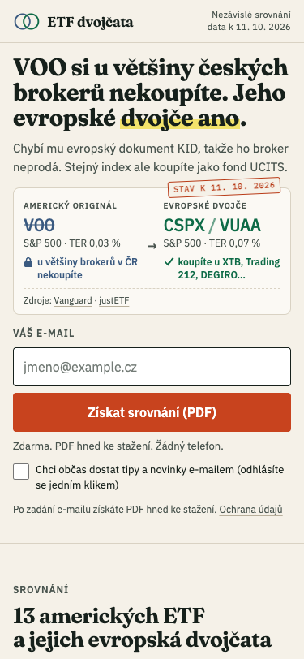
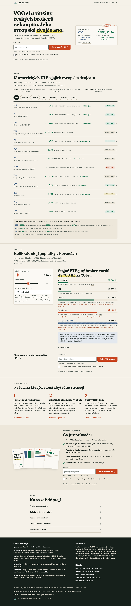
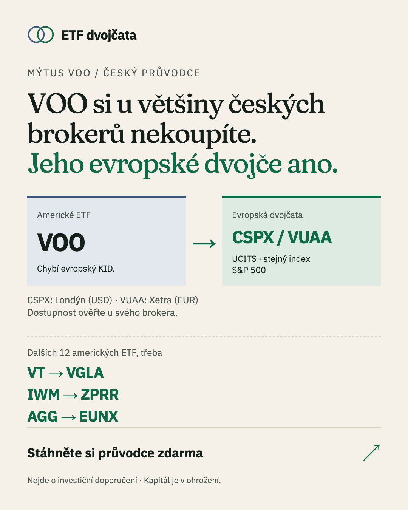
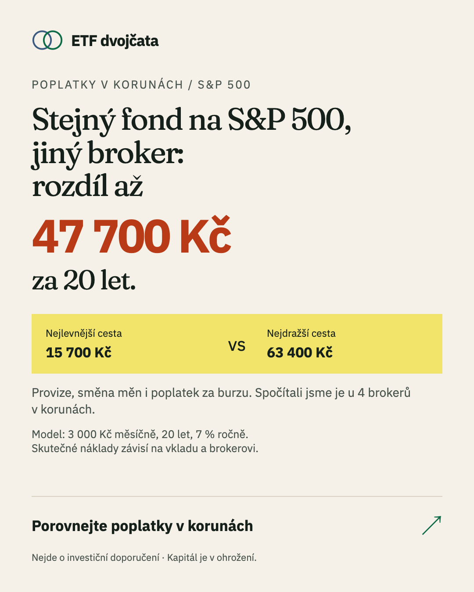

# ETF dvojčata — lead-magnet landing page for Czech ETF beginners

**Live:** https://etf-dvojcata.vercel.app
(ad versions: [`?utm_content=voo`](https://etf-dvojcata.vercel.app/?utm_source=meta&utm_medium=paid_social&utm_content=voo) ·
[`?utm_content=fx`](https://etf-dvojcata.vercel.app/?utm_source=meta&utm_medium=paid_social&utm_content=fx))

Assignment B: a landing page comparing NYSE-traded ETFs for a Czech retail investor who comes from a mobile ad,
gives the page a few seconds, and should leave an email.

| Mobile, first screen | Desktop |
|---|---|
|  |  |

## The one decision that shapes everything

A Czech retail investor **can't buy most NYSE ETFs**. US funds (VOO, SPY, IVV, VTI…) don't publish a PRIIPs KID,
so XTB, Trading 212, DEGIRO, IBKR and Saxo block them for retail clients. Saxo's Czech price list says it outright.
The exception is Fio e-Broker (execution-only, ČNB Q&A RS2018-12), but it charges $7.95 per US trade.

A page that "compares NYSE ETFs" would promise something the visitor finds out at the broker they can't act on.
So the NYSE ETFs stay as the **hook** (that's what people hear about) and the **value** is the honest answer:
*"VOO si u většiny českých brokerů nekoupíte. Jeho evropské dvojče ano."* Every NYSE ETF is paired with the UCITS
fund that tracks the same index and can be bought from Czechia, and fees are shown in korunas.
None of the Czech finance ads in the Meta Ad Library used this angle (checked 11 Oct 2026). Full reasoning: [docs/STRATEGY.md](docs/STRATEGY.md).

## What's in the repo

| Deliverable | Where |
|---|---|
| Target group, offer, when we ask, section order, expected conversion, A/B hypotheses | [docs/STRATEGY.md](docs/STRATEGY.md) |
| Two ad versions (copy, creatives 4:5 and 9:16, targeting, budget, kill rules, compliance) | [ads/README.md](ads/README.md), [ads/out/](ads/out/) |
| The lead magnet (8-page PDF guide) | [public/pruvodce-etf.pdf](public/pruvodce-etf.pdf), source in [guide/](guide/) |
| Page | `index.html`, [src/](src/) — Vite + vanilla TypeScript, hand-written CSS |
| Fee calculator model + tests | [src/calc.ts](src/calc.ts), [src/calc.test.ts](src/calc.test.ts), fees in [src/brokers.ts](src/brokers.ts) |
| Funnel tracking, lead capture, stats API | [src/track.ts](src/track.ts), [api/](api/), [lib/](lib/), [db/schema.sql](db/schema.sql) |
| Private funnel dashboard | `/stats.html` (asks for `STATS_TOKEN`) |
| Research with a source and date for every number | [research/](research/) |
| Conversation exports | [ai-log/](ai-log/) |

## Ads

| A — "Mýtus VOO" (`utm_content=voo`) | B — "Poplatky v korunách" (`utm_content=fx`) |
|---|---|
|  |  |

The first screen repeats the promise of the ad the visitor clicked: the H1 and subline switch on `utm_content`.
The 47 700 Kč in ad B is the calculator's own output for its default scenario (3 000 Kč a month, 20 years, 7 % a year):
Trading 212 15 700 Kč vs Fio e-Broker 63 400 Kč in fees and lost growth. Most of that gap is Fio's per-trade commission,
so the ad talks about fees in general rather than currency conversion.

## Section order (short version)

1. **Hero** — ad promise repeated, the VOO → CSPX/VUAA twin card, a one-field email form. Decided visitors convert here.
2. **Twin table** — the promised value, ungated. Proves the page isn't bait.
3. **Fee calculator in Kč** — the personal "aha"; the second form sits right under the result.
4. **3 things that cost Czechs money** — currency conversion, W-8BEN/dividends, the 3-year tax test.
5. **What's in the guide** — page previews, third form.
6. **FAQ**, then the footer with privacy notice, sources, methodology and the ČNB/MAR disclaimers.

A sticky "Získat PDF srovnání" button follows on mobile once the hero form is out of view. Why this order: [docs/STRATEGY.md](docs/STRATEGY.md#section-order-and-why).

## Expected conversion and A/B hypotheses

**5–8 % visitor → lead** from cold Meta traffic, 6 % for planning. Anchors: Unbounce 2024 — finance median 8.3 %,
the investing subcategory 3.9 %, finance from paid social 9.3 %. Higher than the investing median because the ask is one
field for a free PDF, not an account; lower than finance overall because the traffic is cold, mobile and the topic needs reading.

Hypotheses, ordered by expected impact:
1. **Message match per ad vs one generic hero** — +15–30 % relative lead rate; acts on every visitor in the first 3 seconds. *Already wired:* the hero follows `utm_content`.
2. **Form in the hero vs form only after the calculator** — hero form more leads, calculator-first possibly better leads. *Already wired:* 50/50 per page load, reported as `variant` (`voo-hero`, `fx-calc`, …).
3. **2-tap micro-quiz before the email vs plain email field** — vendor data says quiz funnels do 8–11 %, weak evidence, so third. Event type `quiz_answer` is ready in the API.

## Measurement

Every step from arrival to submitted form is tracked first-party, **without cookies** (a random session id lives only
in page memory), so it works for people who decline cookies and needs no consent banner:

`page_view → engaged_5s/15s → section_view → scroll_depth → calc_change / compare_filter / twin_open → cta_click → form_view → form_focus → form_submit → lead_ok → pdf_download → broker_answer`

Events carry the variant and UTM tags; `GET /api/stats` (Bearer `STATS_TOKEN`) returns the funnel with step and overall
conversion, split by variant, ad (`utm_content`) and device, plus daily leads and median time to lead. `lead_ok` is
written by the server, so the lead count doesn't depend on the browser.
Meta Pixel / GA4 load only if `VITE_META_PIXEL_ID` / `VITE_GA4_ID` are set **and** the visitor accepts; without the IDs
there's no consent bar at all. Verified on production on 11 Oct 2026 with a real mobile browser session (all 10 event
types arrived, lead stored, invalid domain rejected, stats endpoint returns 401 without the token).

## Privacy and compliance

- Email only. The PDF is delivered for the email; **marketing consent is a separate, unticked checkbox** and never a condition (GDPR art. 7(4), zákon 480/2004 Sb. §7). Each lead stores the privacy-notice version it saw and a consent history.
- No IP addresses or full user agents are stored; bots are flagged.
- Educational comparison, not investment advice; author, date, sources and methodology are on the page (ČNB guidance on finfluencers / MAR). No affiliate links, and the page says so.
- Fonts are self-hosted (no Google Fonts requests). CSP and security headers in [vercel.json](vercel.json).
- Operator details live in [src/site.ts](src/site.ts) so the client can swap them before launch.

## Data

All fund numbers come from issuer pages and justETF, all broker fees from official price lists, each with a source URL and
an "as of" date ([research/etf-data.json](research/etf-data.json), [research/market-cro.md](research/market-cro.md)).
`scripts/build-data.mjs` builds the page data from the JSON at build time — numbers on the page are never typed by hand.
Broker fees are the one exception: they're in [src/brokers.ts](src/brokers.ts), copied from the price lists with links.

## Run it

```sh
npm install
npm run dev          # page + API on localhost; API keeps data in memory unless DATABASE_URL is set
npm test             # 80 tests: calculator, validation, funnel maths, endpoints
npm run build        # builds data, then the page
vercel deploy --prod
```

Environment: `DATABASE_URL` (Neon Postgres, set by the Vercel integration for preview/production only — local dev never
touches the production database), `STATS_TOKEN`, optional `LEAD_WEBHOOK_URL` (the hand-off to an ESP such as Ecomail),
optional `VITE_META_PIXEL_ID`, `VITE_GA4_ID`. Schema: `npm run migrate`.

## What's missing / would do next

- **Email delivery.** The PDF downloads instantly on the page; the follow-up email sequence needs the client's ESP (webhook is ready). I didn't set up a sending domain for a test task.
- **A Czech native speaker's pass over the copy.** I'm not one; the copy was checked for typography and tone but not by a native.
- **Fee data freshness.** Fio, Portu and XTB changed price lists in 2026; the fees need an owner and a monthly check. IBKR, Lynx, Saxo, Revolut and Portu are left out of the calculator because their cost for this case isn't fully known, and the page says so.
- **Meta policy re-check** on the day of launch (the policy page rate-limited my last fetch).
- **Real CPC/CPL for Czech finance** — no public source; replace the planning numbers after 3–5 days of the test.

## How I worked with AI

See [the section at the end](#appendix-how-i-worked-with-ai).

---

## Appendix: how I worked with AI

**Setup.** One orchestrating Claude Code session did the planning, wrote every brief, reviewed
every result and made all decisions. The research and build work went to sub-agents with written
briefs, each in a fresh context. Codex (a different model family) wrote parts of the code (the backend API, the PDF guide and the ad
creatives). Two Claude
subscriptions plus Codex were rotated when a 5-hour usage limit ran out; the conversation moved with
its full context and interrupted agents were resumed.

**What every brief contained.** The goal and the deliverable file, the exact data contract (schema
or API payloads), hard rules ("every number needs a URL and an access date", "never invent a
figure, write *not found*", "quotes must be copied from the raw page text"), what not to touch
(other agents' folders, git config, deploys), "no `git add -A`", and the shape of the final report
(counts, weakest records, what couldn't be verified). Full briefs are at the top of each agent's
log in [ai-log/](ai-log/).

**How the output was checked — I didn't trust reports, I re-ran things.**
- Every agent report was compared with the actual files and commits (git log, file timestamps,
  re-running the tests myself).
- Numbers: automatic quote check against the live page for every value; the claimed number/date
  must be inside the quote; a rule engine recomputes every decision and lists disagreements.
- A blind second review by another model on everything that was kept, then adjudication of each
  disagreement with the evidence re-fetched.
- A person labels a random stratified sample of claims; that's the accuracy number reported.
- Before every commit: grep for tool names and AI mentions in code and commit messages, and a look
  at screenshots for anything visual.

**Agents in this repo.**

| Agent | Brief in one line | Output |
|---|---|---|
| ETF data | Real numbers for the popular NYSE ETFs and their UCITS twins from issuer pages, each with source and as-of date; check what Czech retail can actually buy | `research/etf-data.*` |
| Market & CRO | Czech audience, broker price lists, competitor lead magnets, conversion benchmarks, Czech/EU legal limits | `research/market-cro.md` |
| Backend (Codex) | Cookieless event endpoint, lead endpoint, funnel stats, schema, tests — exact payload contract given | `api/`, `lib/`, `db/` |
| Front end | Build the page from `docs/STRATEGY.md`; design direction, performance budget, tracking spec, A/B variants; screenshots and a real-browser test | `index.html`, `src/` |
| Guide & ads (Codex) | 8-page Czech PDF guide and two Meta ad versions with copy, test plan and compliance checklist | `guide/`, `ads/`, `public/pruvodce-etf.pdf` |

**Where the AI got it wrong (and how it was caught).**
- **The brief's premise.** Both research agents independently found that Czech retail investors
  can't buy most NYSE ETFs (no PRIIPs KID). That changed the whole page; it's the main decision in
  this README. One correction on top: the first conclusion was "nobody sells them", the data agent
  then found Fio e-Broker does (execution-only), so the copy says "u většiny brokerů".
- **Consent bundled with the download.** The backend required `consent: true` to deliver the PDF,
  i.e. marketing consent as the price of the guide. That conflicts with GDPR art. 7(4) and
  Czech law 480/2004 §7. Caught in review against the strategy; I changed it to an optional,
  separate `marketing_consent` and a stored privacy-notice version.
- **Local tests wrote to production.** `vercel env pull` put the production `DATABASE_URL` into
  `.env.local`, so the front-end agent's local test lead landed in the live database. Caught by
  checking the database after deploy; test data deleted, `DATABASE_URL` removed from the
  development environment.
- **An ad that told the wrong story.** Ad B's creative blamed currency conversion for a 47 700 Kč
  difference that comes mostly from one broker's per-trade commission. Caught by tracing the
  number back to the calculator; the ad now shows both ends of the range and the assumptions.
- **Empty space and a wrong count in ad A** ("12 twins" when one fund has no twin) — caught on the
  rendered PNGs.
- **Instructions leaking between contexts.** A research agent wrote its notes in Russian because it
  picked up my personal assistant settings; the brief didn't say "write in English". Caught when
  reading the file before committing; fixed, and every later brief states the language.
- **Shared resources.** One agent's "clean up my scratch files" deleted other agents' files in a
  shared temp folder (including a brief); a research agent's browser navigation took over a tab I
  was using. Fix: every agent gets its own work folder and its own headless browser.
- **Tooling side effects.** `vercel integration add` silently put AI-agent skill files into the
  repo (`.agents/`, `.claude/`); caught in `git status`, removed and excluded.
